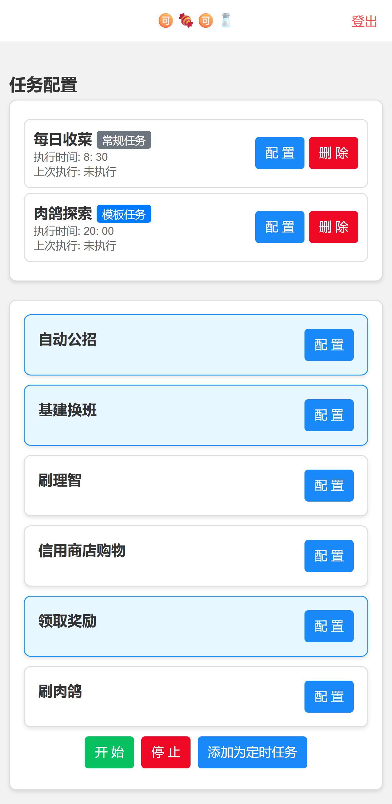
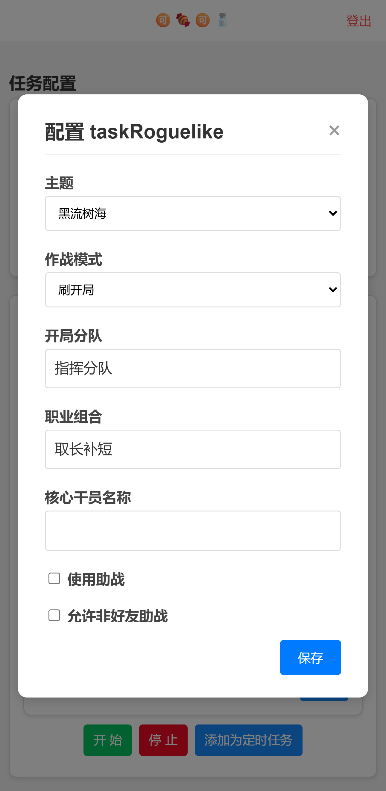
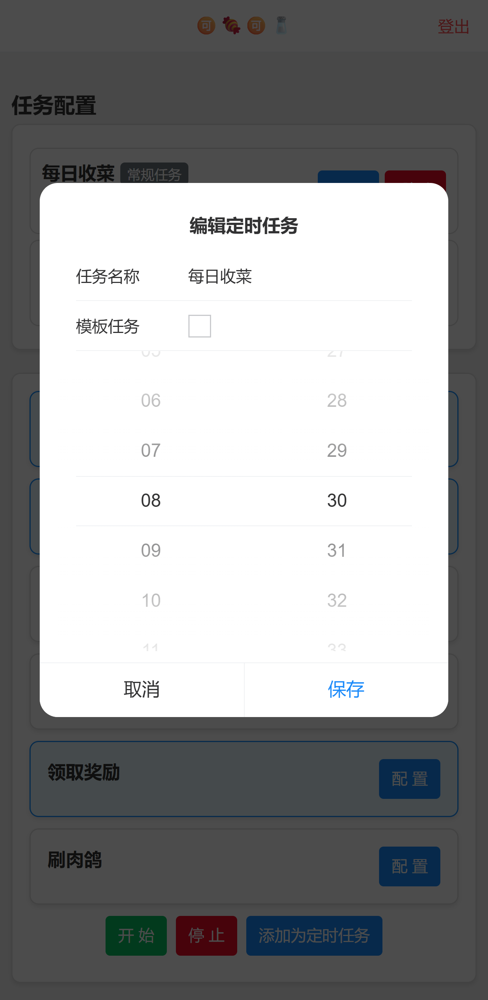
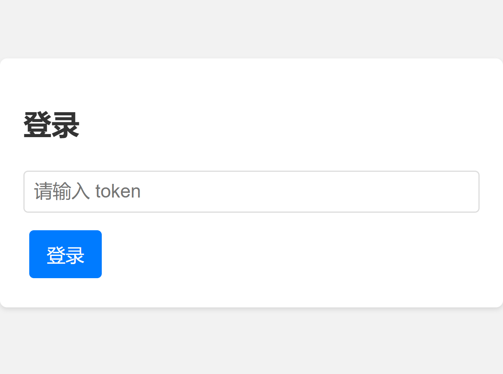
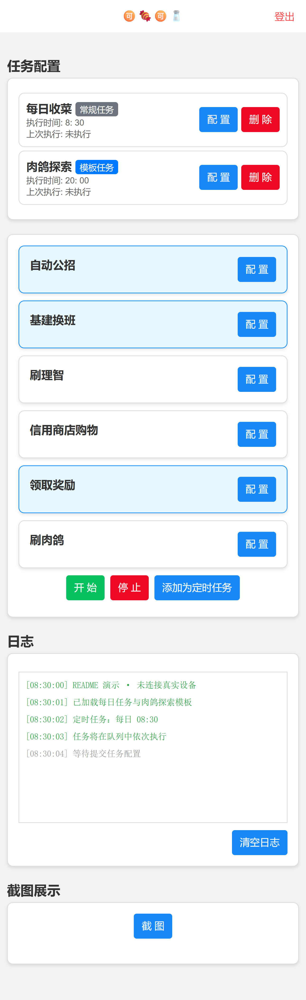

# MAA Web Console · 明日方舟 Web 控制台

基于 [MaaAssistantArknights](https://github.com/MaaAssistantArknights/MaaAssistantArknights) 的个人 Web 控制台。通过浏览器配置任务、安排每日执行时间、查看实时日志和模拟器截图；Go 后端调用本机 MaaCore，通过 ADB 操作模拟器。

后端使用 GoFrame、MySQL 与 JWT，前端使用 Vue 3 和 Vant。它需要你自行安装 MAA、ADB 和模拟器，不包含游戏账号、MaaCore 二进制文件或 MAA 资源包。

## 功能

- 自动公招、基建换班、刷理智、信用商店购物与领取奖励。
- 集成战略任务配置，包含黑流树海的刷等级、刷源石锭、刷襁褓动物和刷开局模式。
- 保存配置为定时任务或模板，支持编辑、删除和手动启动。
- 多实例共用 FIFO 队列，一次执行一批任务；同一实例不可重复排队。
- 按账号推送 WebSocket 日志，通过 ADB 获取当前模拟器截图。
- 执行超时和主动停止时退出游戏；核心停止超时则退出后端进程，供服务管理器重启。

## 界面预览

以下是当前 Vue 前端的手机端实际截图，使用模拟任务与日志，数据不代表真实账号，也未连接或操作游戏。

<table>
  <tr>
    <th>任务配置</th>
    <th>黑流树海配置</th>
  </tr>
  <tr>
    <td valign="top"></td>
    <td valign="top"></td>
  </tr>
  <tr>
    <th>每日定时任务</th>
    <th>访问令牌登录</th>
  </tr>
  <tr>
    <td valign="top"></td>
    <td valign="top"></td>
  </tr>
</table>

<details>
  <summary>查看主页完整长图（含日志与截图入口）</summary>

  <p></p>
</details>

## 运行环境

| 组件 | 要求与说明 |
| --- | --- |
| 操作系统 | Windows x64；当前原生调用依赖 Windows DLL，Linux 后端尚未实现 |
| Go | 1.23.6，与 `go.mod` 的 toolchain 一致 |
| Node.js | 已验证 Node.js 22 / npm 10，前端依赖由 lockfile 固定 |
| MySQL | MySQL 8，保存定时任务；不需要在数据库中保存登录令牌 |
| MAA | 匹配版本的 `MaaCore.dll`、依赖 DLL 和完整 `resource/`；黑流树海需要核心本身支持 |
| ADB 与模拟器 | 能通过 `adb connect`、`adb devices` 连接，且游戏已经完成账号登录 |

所有实例必须使用相同的 MaaCore 路径和客户端类型，各自使用不同的 ADB 地址。`maa.userdir` 是进程级目录，不能作为账号隔离机制。

## 安装与本地启动

### 1. 获取源码与依赖

克隆本仓库后，在根目录运行：

```powershell
go mod download
Set-Location web
npm ci
Set-Location ..
```

根目录 `main.go` 是维护中的后端入口。`Golang/` 是历史原型，`manifest/docker/` 和 `manifest/deploy/` 是遗留模板，不是可用的 Linux 后端部署方案。

### 2. 初始化数据库

先用管理员账号登录 MySQL，创建数据库和只用于本项目的账号。下面的密码必须自行更换，不要使用数据库 root 账号运行应用。

```sql
CREATE DATABASE maa CHARACTER SET utf8mb4;
CREATE USER 'maa'@'127.0.0.1' IDENTIFIED BY 'CHANGE_ME_TO_A_RANDOM_DATABASE_PASSWORD';
GRANT SELECT, INSERT, UPDATE, DELETE ON maa.* TO 'maa'@'127.0.0.1';
USE maa;
SOURCE C:/path/to/maa-backend/manifest/sql/schema.sql;
```

将 `SOURCE` 路径替换为你的实际位置。仓库只提供空表结构，不包含账号或历史任务数据；已有数据库请先备份并核对字段，`CREATE TABLE IF NOT EXISTS` 不会升级旧表。

### 3. 创建本地配置

在根目录执行：

```powershell
.\hack\init-config.ps1 -ResourcePath 'C:\MAA' -AdbPath 'C:\platform-tools\adb.exe' -AdbAddress '127.0.0.1:16384'
```

脚本从 [配置示例](manifest/config/config.example.yaml) 生成 `manifest/config/config.yaml`，为 JWT 和登录令牌分别生成随机值，不覆盖已有配置。也可手动复制示例并填写全部配置；示例中的空凭据不能启动服务。

在本地编辑生成的文件：

- 将 `database.default[0].link` 中的数据库密码改为上一步的实际密码。
- 核对 `maa.asst[0]` 中的 ADB 地址、ADB 路径、连接配置 `adbtype` 和 MAA 根目录。
- `resourcepath` 指向同时包含 `MaaCore.dll` 与 `resource/` 的目录，不能直接指向 `resource/`。
- `auth.users[].username` 必须匹配 `maa.asst[].id`。增加实例时，添加对应用户，并使用独立随机登录令牌。
- 在本地查看 `auth.users[].token`，它是前端登录使用的访问令牌；不要把 `auth.jwtsecret` 当作登录令牌分发。

JWT 密钥与每个登录令牌至少 32 字节，建议使用初始化脚本生成的随机值。可以用 `MAA_JWT_SECRET` 覆盖签名密钥，用 `MAA_LOGIN_TOKENS` 覆盖用户配置；后者是 JSON 对象，键为实例 ID，值为该实例的随机登录令牌。设置用户环境变量时会替换整个用户列表。

真实配置、证书、`.env`、数据库备份、运行目录与日志都已排除出 Git。前端的 `VUE_APP_*` 变量会进入公开的 JS 文件，不能用于保存秘密。

### 4. 检查 ADB 并启动后端

```powershell
& 'C:\platform-tools\adb.exe' connect '127.0.0.1:16384'
& 'C:\platform-tools\adb.exe' devices
go run .
```

默认后端地址为 `http://127.0.0.1:5244`。必须从仓库根目录启动，以正确找到配置和静态资源。启动失败时先检查凭据长度、实例 ID、数据库连接、DLL 依赖和资源路径。

后端根路径提供一个简化的内置页面；完整 Vue 控制台需要单独启动前端。

### 5. 启动前端

另开终端：

```powershell
Set-Location web
npm run serve
```

打开 `http://127.0.0.1:8083`，输入本地配置中的登录令牌。开发服务器会把 `/maasst` 请求和 WebSocket 转发到本机 5244 端口。

## 使用方式

1. 登录后，点击任务卡片选择要执行的任务，再点击右侧“配置”调整参数。
2. 点击“开始”提交当前选中的任务；提交成功表示进入队列，实际执行结果以日志为准。点击“停止”取消当前账号的排队任务或停止正在执行的任务。
3. 在“刷肉鸽”配置里选择主题和模式。黑流树海的路线、动物及开局选项会随模式显示；具体可用内容取决于所安装核心与游戏解锁状态。
4. 点击“添加为定时任务”，填写名称和每天的执行时间。勾选“模板任务”只保存配置，不会自动运行。选择已有任务可加载配置，修改后点击“保存定时任务”。
5. 定时任务使用后端系统时间，在设定时间前后约 5 分钟内随机执行；服务必须保持运行。不同账号的任务依次排队。
6. 日志区显示当前账号的执行状态；“截图”读取该账号配置的模拟器画面，不会自动开始游戏任务。
7. 点击右上角“登出”清除当前浏览器中的 JWT。JWT 有效期为 24 小时，过期后重新登录。

任务队列只保存在内存，后端重启后不会恢复排队任务。修改 DLL、资源根目录或鉴权配置后需要重启服务。

## 部署

### Windows 后端

```powershell
go build -o bin/maa-backend.exe .
.\bin\maa-backend.exe
```

将项目根目录设为服务工作目录，保留本地 `manifest/config/config.yaml` 和 `resource/public/html/`，确保服务账号可以访问 MAA、ADB 及模拟器。可使用自己的 Windows 服务管理器托管程序，配置异常退出后重启。不要与桌面 MAA 同时控制同一个模拟器。

默认保持后端监听回环地址。需要跨设备访问时，使用受控网络与 HTTPS 反向代理，只开放必要的前端入口；不要将 ADB、MySQL 或后端端口直接暴露到公网。默认配置不启用 Swagger/OpenAPI。

### Vue 静态站点与 Nginx

```powershell
Set-Location web
npm run build
```

将 `web/dist/` 部署为静态站点。Nginx 需要将 SPA 路由回退到 `index.html`，并代理 `/maasst/`，同时支持 WebSocket 升级与长连接。可参考 [Nginx 配置](web/nginx.conf)。Nginx 与后端都运行在宿主机时，将 `proxy_pass` 改为 `http://127.0.0.1:5244`。

前端也可在 Windows Docker Desktop 中运行：

```powershell
docker build -t maa-web .
docker run -d --name maa-web -p 127.0.0.1:8080:80 maa-web
```

示例容器通过 `host.docker.internal:5244` 访问宿主机。**仅监听 `127.0.0.1` 的后端无法通过该地址访问**：若使用此方案，必须另外选择容器可访问的宿主机接口，并通过防火墙限制来源。也可在宿主机直接运行 Nginx，继续让后端只监听回环地址。前端 Docker 镜像不包含后端、数据库或 MaaCore。

公网入口应由反向代理提供可信 HTTPS 证书。若使用 `web/withcert.dockerfile` 和 [TLS 示例](web/nginx.tls.conf.example)，证书目录需要在运行时只读挂载到 `/etc/nginx/ssl`；不要把私钥复制进镜像。Cloudflare Origin 证书用于 Cloudflare 到源站的链路，不能替代浏览器直连所需的公开可信证书。

浏览器 WebSocket 使用 URL 参数携带 JWT，因此代理中 `/maasst/` 的访问日志默认关闭；接入其他网关、CDN 或监控时也需隐藏此类查询参数。

## 开发与验证

```powershell
go test ./...
go vet ./...
python scripts/audit-publication.py --history
Set-Location web
npm run test:task-config
npm run build
```

普通后端测试不操作真实模拟器。`MAA_NATIVE_SMOKE=1` 会启用需要本地 MaaCore 的 ABI 验证，`MAA_INTEGRATION_TEST=1` 会启用可能操作设备的集成测试，请仅在明确需要时开启。

`npm run build` 的 `prebuild` 会将共享任务定义同步到后端内置页面；不要手工维护两份不同的任务参数。

```text
api/                   GoFrame API 定义
internal/auth/         私有凭据加载、登录与 JWT 校验
internal/controller/   HTTP、WebSocket 与定时任务接口
internal/logic/maa/     MaaCore、ADB、资源管理与执行队列
internal/logic/croner/  每日任务调度
manifest/config/       可公开示例与被忽略的本地配置
manifest/sql/          不含用户数据的初始化表结构
resource/public/html/  后端内置简化页面
web/                   Vue 3 前端
docs/                  功能说明与脱敏界面截图
scripts/               发布前的本地检查
```

更多说明：[任务队列与资源加载](docs/maa-queue.md)、[黑流树海支持](docs/blackflow.md)、[发布与敏感信息处理](docs/publication-security.md)。

## 常见问题

| 现象 | 检查项 |
| --- | --- |
| 启动提示鉴权配置错误 | JWT 和登录令牌是否至少 32 字节、是否互不相同、用户是否匹配实例 ID |
| 找不到 DLL 或加载失败 | 是否为 Windows x64，`resourcepath` 是否正确，MAA 依赖 DLL 是否完整 |
| 任务已提交但没有立即执行 | 是否正在等待其他账号完成；通过日志确认出队情况 |
| 读取定时任务失败 | MySQL 是否可达，连接账号是否有权限，是否已导入表结构 |
| 页面可开但请求失败 | 前端代理是否能访问后端，Docker 到宿主机的监听地址是否正确 |
| HTTPS 页面没有实时日志 | 反向代理是否转发 WebSocket 的 Upgrade/Connection 头与正确的 Host |
| 肉鸽配置正常但游戏执行失败 | 核心与资源是否匹配，模拟器首页、主题解锁和核心识别是否正常 |

## Credits · 开源致谢

感谢以下开源项目及其贡献者：

| 项目 | 在本项目中的用途 | 许可证 |
| --- | --- | --- |
| [MaaAssistantArknights](https://github.com/MaaAssistantArknights/MaaAssistantArknights) | MaaCore 任务执行引擎与 C 接口 | AGPL-3.0-only |
| [GoFrame](https://github.com/gogf/gf) | Go 后端、数据库访问与每日任务调度 | MIT |
| [Vue](https://github.com/vuejs/core) / [Vue Router](https://github.com/vuejs/router) | 前端界面与路由 | MIT |
| [Vant](https://github.com/vant-ui/vant) | 移动端组件、弹窗与时间选择器 | MIT |
| [golang-jwt/jwt](https://github.com/golang-jwt/jwt) | JWT 签发与校验 | MIT |
| [Logrus](https://github.com/sirupsen/logrus) | 后端日志与日志回调 | MIT |
| [Gorilla WebSocket](https://github.com/gorilla/websocket) | 实时日志连接 | BSD-2-Clause |
| [Go MySQL Driver](https://github.com/go-sql-driver/mysql) | MySQL 数据库驱动 | MPL-2.0 |
| [Android Debug Bridge](https://android.googlesource.com/platform/packages/modules/adb/) | 模拟器连接、设备控制与截图 | Apache-2.0 |

完整的主要依赖、构建工具、历史依赖及外部运行组件说明见 [CREDITS.md](CREDITS.md)。第三方项目保留各自的版权与许可证。

## 许可证

本项目的原创代码采用 **GNU Affero General Public License v3.0 only（SPDX：`AGPL-3.0-only`）**，全文见 [LICENSE](LICENSE)。这一选择与 [MaaAssistantArknights 的上游许可声明](https://github.com/MaaAssistantArknights/MaaAssistantArknights#声明) 保持一致。

修改并分发本项目时，须依照 AGPL-3.0 提供对应源代码；将修改版作为网络服务供他人使用时，也须按许可证向这些用户提供对应源代码的获取方式。具体权利、义务与免责条款以许可证全文为准。

本项目是个人开发的非官方控制台，与 MAA 官方、鹰角网络、Hypergryph 无隶属关系。MAA、游戏素材、商标及其他第三方内容的权利归各自权利人，本项目的许可证不替代这些内容的原有许可。
